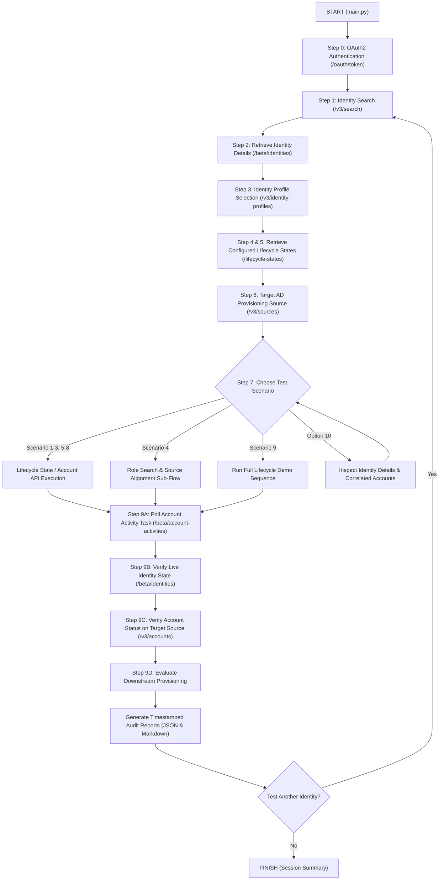
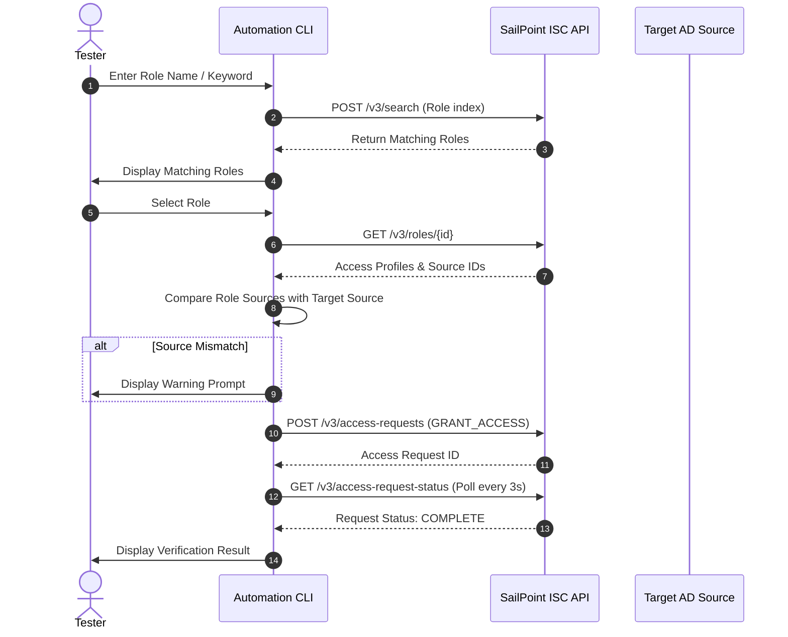

# SailPoint ISC AD Provisioning Automation - Complete Workflow Guide

This document describes the end-to-end workflow of the automation framework, including the interactive 9-step testing process, scenario lifecycle flows, validation hierarchy, and report generation.

---

## 1. High-Level Architecture Diagram



---

## 2. The 9-Step Interactive Flow Breakdown

### Step 0: Authentication
* **Module**: `authentication/auth_client.py`
* **API**: `POST /oauth/token`
* **Action**: Requests a Bearer token using PAT `client_id` and `client_secret` from `.env`. Caches token in memory and automatically refreshes when expired.

### Step 1: Prompt for User (Search)
* **Module**: `sailpoint/identity.py`
* **API**: `POST /v3/search`
* **Action**:
  * Tester enters a Name, Email, or ID.
  * If left blank, retrieves the first 15 test identities loaded from the Delimited File source.
  * Displays a numbered table of matching users for tester selection.

### Step 2: Retrieve User Details
* **Module**: `sailpoint/identity.py`
* **API**: `GET /beta/identities/{id}` + search indexing
* **Action**: Displays the clean Identity Card: Name, Email, Department, Current Lifecycle State, Primary Source, Account ID, and Last Modified timestamp.

### Step 3: Identity Profile Selection
* **Module**: `sailpoint/identity_profiles.py`
* **API**: `GET /v3/identity-profiles`
* **Action**: Defaults to the identity's linked profile (e.g. `Truist Employee Profile`). If rejected or unassigned, lists all tenant profiles for selection.

### Step 4 & 5: Retrieve Configured Lifecycle States
* **Module**: `sailpoint/identity_profiles.py`
* **API**: `GET /v3/identity-profiles/{profile_id}/lifecycle-states`
* **Action**: Dynamically pulls all configured states (`preHire`, `active`, `skp`, `ear`, `loa`, `terminated`) directly from tenant configuration, showing their technical names and expected AD provisioning outcomes.

### Step 6: Prompt for Target Source
* **Module**: `sailpoint/sources.py`
* **API**: `GET /v3/sources`
* **Action**: Defaults to the user's primary source (`AD_Demo_Source`). Displays available Active Directory and delimited file sources if another source is requested.

### Step 7: Prompt for Scenario / Use Case
Presents the 10 available options:
```text
  1. Create Account
  2. Enable Account
  3. Disable Account
  4. Role Request (interactive sub-flow with source validation)
  5. Termination (employmentTermination - requires confirmation)
  6. Leave of Absence - LOA (loa)
  7. Sabbatical - SKP (skp)
  8. Emergency Access Removal - EAR (ear - requires confirmation)
  9. Run All Lifecycle Transitions Demo (Active -> SKP -> LOA -> EAR -> Termination)
 10. View Identity Details, Correlated Accounts & Source Attributes (Inspect UI Views)
  0. Back / Finish Session
```

---

## 3. Scenario Execution Details

### Scenario 1: Create Account
1. Applies `active` state via `POST /v3/identities/{id}/set-lifecycle-state`.
2. Checks if an account exists on target source; creates one if absent via `POST /v3/accounts`.
3. Validates provisioning task completion and verifies resulting `active` state and account creation.

### Scenario 2: Enable Account
1. Applies `active` state to trigger onboarding/enable policy.
2. Sends explicit enable request to target account via `POST /v3/accounts/{id}/enable` with `{"forceProvisioning": false}`.
3. Validates task activity and verifies target account is enabled.

### Scenario 3: Disable Account
1. Applies configured disabled state (`loa` / `skp` / `ear`).
2. Sends explicit disable request via `POST /v3/accounts/{id}/disable`.
3. Validates task activity and verifies account status is disabled.

### Scenario 4: Role Request Sub-Flow


### Scenario 5: Employment Termination
* **Safety Prompt**: Requires typing `TERMINATE` before continuing.
* Applies `terminated` (or `employmentTermination`) state.
* Verifies account is disabled or deprovisioned, and all entitlements are revoked.

### Scenario 6: Leave of Absence (LOA)
* Applies `loa` state.
* Verifies downstream AD account is suspended/disabled while attributes are preserved.

### Scenario 7: Sabbatical (SKP)
* Sabbatical abbreviation standardized project-wide as **`SKP`**.
* Applies `skp` state.
* Validates task completion and verifies `lifecycleState.stateName == "skp"` with retained attributes.

### Scenario 8: Emergency Access Removal (EAR)
* High-impact security operation.
* **Safety Prompt**: Requires explicit confirmation (`EAR-CONFIRM`). Restricted to non-production tenants.
* Applies `ear` state and immediately disables target AD access.

### Scenario 9: Full Lifecycle Transitions Demo
Executes the sequential end-to-end lifecycle demonstration on the selected identity:
`Active` ➔ `SKP` ➔ `LOA` ➔ `EAR` ➔ `Termination`

### Option 10: Inspect UI Views & Correlated Accounts
Displays:
1. **Identity Details View** (Matches Image 1 in console).
2. **Correlated Accounts Summary Table** (Matches Image 2).
3. **Drill-down menu**:
   * Enter a number (`1`, `2`, ...) to view raw source feed attributes for a specific account (Matches Image 3).
   * Enter `A` to view all accounts sequentially.
   * Enter `B` to return back to the scenario menu.

---

## 4. Multi-Tier Validation Hierarchy (Step 9)

Every test scenario executes a 4-tier validation sequence:

```
+-----------------------------------------------------------------------------+
| Tier 1: Provisioning Activity Polling                                       |
| Polling GET /beta/account-activities/{id} until status is SUCCESS/COMPLETED |
+-----------------------------------------------------------------------------+
                                       |
                                       v
+-----------------------------------------------------------------------------+
| Tier 2: Real-time Live Identity State Verification                          |
| Querying GET /beta/identities/{id} directly to verify technical state       |
+-----------------------------------------------------------------------------+
                                       |
                                       v
+-----------------------------------------------------------------------------+
| Tier 3: Target Account Existence & Status Verification                      |
| Inspecting GET /v3/accounts for root disabled flag & AD userAccountControl  |
+-----------------------------------------------------------------------------+
                                       |
                                       v
+-----------------------------------------------------------------------------+
| Tier 4: Downstream Policy & AD Outcome Evaluation                           |
| Correlating final account state against configured profile expectation      |
+-----------------------------------------------------------------------------+
```

---

## 5. Audit Logging & Reporting

At the end of every execution:
1. **Console Summary**: Displays a clean summary table of all executed scenarios and their `SUCCESS` / `FAILURE` status.
2. **JSON Audit Report**:
   * Saved to: `reports/test_report_<TIMESTAMP>.json`.
   * Machine-readable format containing full scenario parameters, identity details, API operations, and check outcomes.
3. **Markdown Executive Summary**:
   * Saved to: `reports/test_summary_<TIMESTAMP>.md`.
   * Human-readable document with executive tables, check results, and failure rationales.
4. **Execution Log**:
   * Saved to: `logs/execution.log`.
   * Complete timestamped audit trail with all HTTP requests, status codes, and automatic token redaction.
