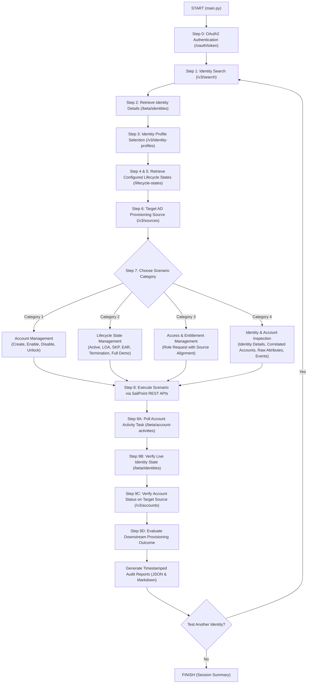

# SailPoint ISC AD Provisioning Automation - Complete Workflow Guide

This document describes the end-to-end workflow of the automation framework, including the interactive 9-step testing process, scenario lifecycle flows, validation hierarchy, and report generation.

---

## 1. High-Level Architecture Diagram



---

## 2. The 9-Step Interactive Flow Breakdown

### Step 0: Authentication
* **Module**: `authentication/auth_client.py`
* **API**: `POST /oauth/token`
* **Action**: Requests a Bearer token using PAT `client_id` and `client_secret` from `.env`. Caches token in memory and automatically refreshes when expired.

### Step 1: Prompt for User (Search)
* **Module**: `sailpoint/identity.py`
* **API**: `POST /v3/search`
* **Action**:
  * Tester enters a Name, Email, or ID.
  * If left blank, retrieves the first 15 test identities loaded from the Delimited File source.
  * Displays a numbered table of matching users for tester selection.

### Step 2: Retrieve User Details
* **Module**: `sailpoint/identity.py`
* **API**: `GET /beta/identities/{id}` + search indexing
* **Action**: Displays the clean Identity Card: Name, Email, Department, Current Lifecycle State, Primary Source, Account ID, and Last Modified timestamp.

### Step 3: Identity Profile Selection
* **Module**: `sailpoint/identity_profiles.py`
* **API**: `GET /v3/identity-profiles`
* **Action**: Defaults to the identity's linked profile (e.g. `Truist Employee Profile`). If rejected or unassigned, lists all tenant profiles for selection.

### Step 4 & 5: Retrieve Configured Lifecycle States
* **Module**: `sailpoint/identity_profiles.py`
* **API**: `GET /v3/identity-profiles/{profile_id}/lifecycle-states`
* **Action**: Dynamically pulls all configured states (`preHire`, `active`, `skp`, `ear`, `loa`, `terminated`) directly from tenant configuration, showing their technical names and expected AD provisioning outcomes.

### Step 6: Prompt for Target Source
* **Module**: `sailpoint/sources.py`
* **API**: `GET /v3/sources`
* **Action**: Defaults to the user's primary source (`AD_Demo_Source`). Displays available Active Directory and delimited file sources if another source is requested.

### Step 7: Prompt for Scenario Category & Scenario Selection
Presents a 2-tier categorized menu managed by `MenuManager`:

```text
================================================================================
  [Step 7/9] TEST SCENARIO CATEGORY SELECTION
  Target User   : Yuki Nagato (2c9180868f...)
  Current State : active
  Target Source : AD_Demo_Source
================================================================================
  [1] Account Management               - Create, Enable, Disable, and Unlock Target Accounts
  [2] Lifecycle State Management       - Active, LOA, SKP, Termination, and Full Lifecycle Demo
  [3] Access & Entitlement Management  - Role Requests with Source Validation and Entitlement Checks
  [4] Identity & Account Inspection    - Identity Details, Correlated Accounts, and Raw Inbound Attributes
  ------------------------------------------------------------------------------
  [0] Back to Identity Selection / Finish Session
================================================================================
```

When a category is selected, the sub-menu presents the domain-isolated scenarios registered under that category.

---

## 3. Domain Categorization & Scenario Details

### Category 1: Account Management
* **`account.create` (Create Target Account)**: Applies `active` state and provisions a new AD account via `POST /v3/accounts` if not present.
* **`account.enable` (Enable Account)**: Explicitly enables an existing AD account via `POST /v3/accounts/{id}/enable`.
* **`account.disable` (Disable Account)**: Explicitly disables target account via `POST /v3/accounts/{id}/disable`.
* **`account.unlock` (Unlock Account)**: Clears AD lockout flag by updating `userAccountControl` via `POST /v3/accounts/{id}/unlock`.

### Category 2: Lifecycle State Management
* **`lifecycle.active` (Active - Onboarding / Rehire)**: Applies `active` state and verifies standard AD account enablement.
* **`lifecycle.loa` (Leave of Absence - LOA)**: Applies `loa` state and verifies downstream AD account suspension.
* **`lifecycle.skp` (Sabbatical - SKP)**: Sabbatical abbreviation standardized project-wide as **`SKP`**. Applies `skp` state and verifies sabbatical policy enforcement while retaining attributes.
* **`lifecycle.ear` (Emergency Access Removal - EAR)**: High-impact security transition requiring `EAR-CONFIRM` safety confirmation; disables account and revokes access.
* **`lifecycle.termination` (Employment Termination)**: High-impact transition requiring `TERMINATE` safety confirmation; revokes access and disables/removes target account.
* **`lifecycle.full_demo` (Full Lifecycle Demonstration)**: Executes the end-to-end sequential transition sequence: `Active` ➔ `SKP` ➔ `LOA` ➔ `EAR` ➔ `Termination`.

### Category 3: Access & Entitlement Management
* **`access.role_request` (Role Request with Source Alignment)**:
  1. Searches tenant roles by keyword (`/v3/search` & `/v3/roles`).
  2. Inspects role's access profiles and underlying provisioning source IDs.
  3. Validates whether the role provisions to the tester's selected target source (warns tester on mismatch).
  4. Submits access request via `POST /v3/access-requests`.
  5. Polls `/beta/access-request-status` until completed.

### Category 4: Identity & Account Inspection
* **`inspection.identity_details`**: Comprehensive identity model inspection (Identity Card, Attributes, Email, Lifecycle State).
* **`inspection.view_accounts`**: Summary table of all correlated accounts (AD, Delimited, IdentityNow) and drill-down into raw attributes.
* **`inspection.source_attributes`**: Direct inspection of the target source account's raw schema attributes.
* **`inspection.event_attributes`**: Queries the SailPoint audit event trail via `POST /v3/search` with `indices: ["events"]` to inspect identity lifecycle changes and provisioning event attributes.

---

## 4. Generic Modular Architecture & Adding New Scenarios

The framework utilizes an extensible, decoupled architecture:

```
core/
├── base_scenario.py     # BaseScenario abstract class
├── context.py           # ExecutionContext (identity, source, profile, report_gen)
├── registry.py          # ScenarioRegistry with dynamic auto-discovery
└── menu_manager.py      # Two-tier hierarchical interactive navigation
scenarios/
├── account_management/  # Domain module
├── lifecycle_management/# Domain module
├── access_management/   # Domain module
└── inspection/          # Domain module
```

### How to Add a New Test Scenario:
1. Create a new file inside the appropriate domain folder (e.g. `scenarios/lifecycle_management/extended_leave.py`).
2. Subclass `BaseScenario` and decorate with `@register_scenario`:
```python
from core.base_scenario import BaseScenario
from core.context import ExecutionContext
from core.registry import register_scenario
from reporting.report_generator import TestReportItem

@register_scenario
class ExtendedLeaveScenario(BaseScenario):
    scenario_id = "lifecycle.extended_leave"
    name = "Extended Medical Leave"
    category_id = "lifecycle_management"
    category_name = "Lifecycle State Management"
    description = "Apply extended medical leave state and suspend account"
    expected_ad_outcome = "Suspend AD account"
    order = 7

    def execute(self, ctx: ExecutionContext) -> TestReportItem:
        # Implementation logic here
        ...
```
3. The new scenario will **automatically appear** in the CLI menu under the selected category without modifying `main.py` or any existing scenarios!

---

## 5. Multi-Tier Validation Hierarchy (Step 9)

Every test scenario executes a 4-tier validation sequence:

```
+-----------------------------------------------------------------------------+
| Tier 1: Provisioning Activity Polling                                       |
| Polling GET /beta/account-activities/{id} until status is SUCCESS/COMPLETED |
+-----------------------------------------------------------------------------+
                                       |
                                       v
+-----------------------------------------------------------------------------+
| Tier 2: Real-time Live Identity State Verification                          |
| Querying GET /beta/identities/{id} directly to verify technical state       |
+-----------------------------------------------------------------------------+
                                       |
                                       v
+-----------------------------------------------------------------------------+
| Tier 3: Target Account Existence & Status Verification                      |
| Inspecting GET /v3/accounts for root disabled flag & AD userAccountControl  |
+-----------------------------------------------------------------------------+
                                       |
                                       v
+-----------------------------------------------------------------------------+
| Tier 4: Downstream Policy & AD Outcome Evaluation                           |
| Correlating final account state against configured profile expectation      |
+-----------------------------------------------------------------------------+
```

---

## 6. Audit Logging & Reporting

At the end of every execution:
1. **Console Summary**: Displays a clean summary table of all executed scenarios and their `SUCCESS` / `FAILURE` status.
2. **JSON Audit Report**:
   * Saved to: `reports/test_report_<TIMESTAMP>.json`.
   * Machine-readable format containing full scenario parameters, identity details, API operations, and check outcomes.
3. **Markdown Executive Summary**:
   * Saved to: `reports/test_summary_<TIMESTAMP>.md`.
   * Human-readable document with executive tables, check results, and failure rationales.
4. **Execution Log**:
   * Saved to: `logs/execution.log`.
   * Complete timestamped audit trail with all HTTP requests, status codes, and automatic token redaction.

